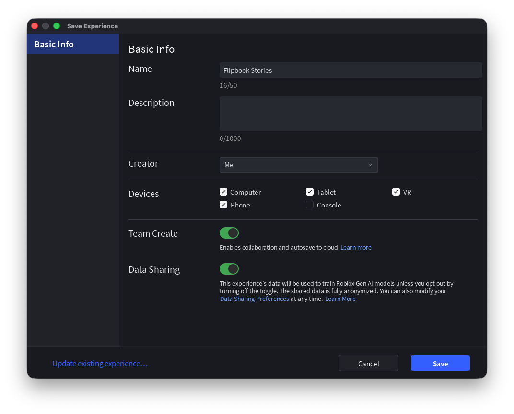
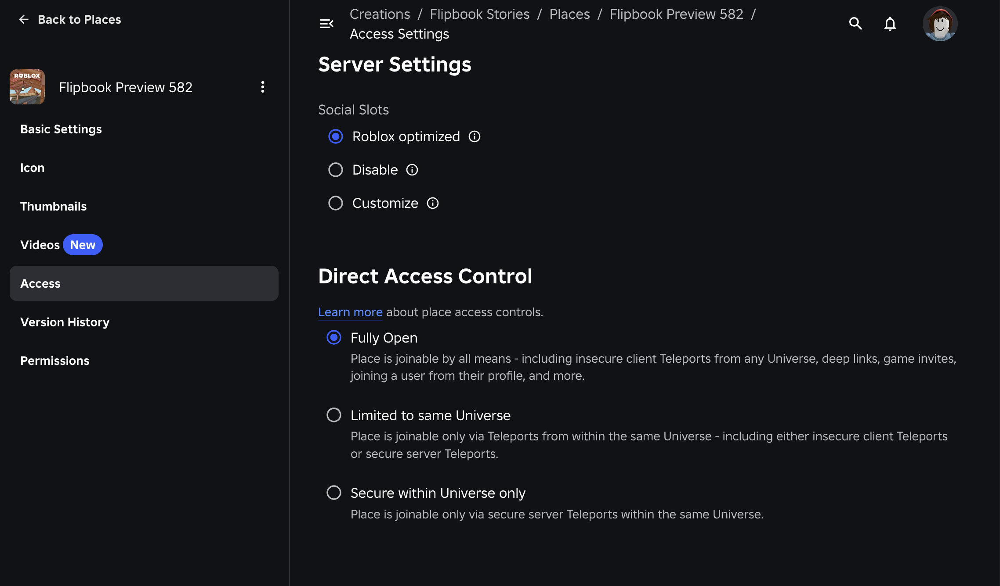
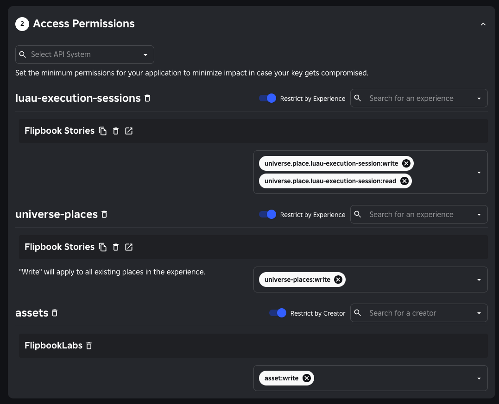

# DeployStorybook

DeployStorybook publishes a [Flipbook](https://github.com/flipbook-labs/flipbook) storybook to a Roblox experience through Open Cloud. Your workflow builds the storybook into a `.rbxl` place file, and the action publishes it. It runs on `ubuntu-latest` and `macos-latest` runners.

On pull requests, it can publish each one to its own place and comment the preview link on the pull request.

## Install

Add the action to a workflow:

```yaml
- uses: flipbook-labs/deploy-storybook@v0.4.1
```

## Use

### One-time setup

1. Create an experience in the [Creator Hub](https://create.roblox.com/dashboard/creations) and publish it. Copy its **UniverseId**.

   

2. Close the experience in Studio. An open session causes "Conflict" errors during deploys.
3. In the start place, enable **Direct Access Control > Fully Open**. This gives each deployment a stable, PR-scoped URL.

   

4. Create an [Open Cloud API key](https://create.roblox.com/dashboard/credentials) with place-publishing access. Restrict it to this experience if you can.

   

5. In your repository, create a [GitHub Environment](https://docs.github.com/en/actions/how-tos/deploy/configure-and-manage-deployments/manage-environments) named `storybook`. Store the key as the secret `ROBLOX_API_KEY` and the UniverseId as the variable `ROBLOX_STORYBOOK_UNIVERSE_ID`. An environment keeps these out of reach of jobs that don't name it.

### Workflow

Build the storybook with Rojo, then pass the file to the action. The job's `environment` gives it the secret and variable from setup.

```yaml
name: Deploy storybook
on:
  push:
    branches: [main]

jobs:
  deploy:
    runs-on: ubuntu-latest
    environment: storybook
    steps:
      - uses: actions/checkout@v6

      - name: Build storybook
        run: rojo build storybook.project.json -o storybook.rbxl

      - uses: flipbook-labs/deploy-storybook@v0.4.1
        with:
          api-key: ${{ secrets.ROBLOX_API_KEY }}
          universe-id: ${{ vars.ROBLOX_STORYBOOK_UNIVERSE_ID }}
          place-name: Flipbook Stories
          place-file: storybook.rbxl
```

## Previews

Deploy each pull request to its own place and have the action comment the preview link. Add `pull-requests: write` so the action can post the comment:

```yaml
name: Deploy storybook
on:
  pull_request:

permissions:
  pull-requests: write

jobs:
  deploy:
    runs-on: ubuntu-latest
    environment: storybook
    steps:
      - uses: actions/checkout@v6

      - name: Build storybook
        run: rojo build storybook.project.json -o storybook.rbxl

      - uses: flipbook-labs/deploy-storybook@v0.4.1
        with:
          api-key: ${{ secrets.ROBLOX_API_KEY }}
          universe-id: ${{ vars.ROBLOX_STORYBOOK_UNIVERSE_ID }}
          place-name: "PR ${{ github.event.pull_request.number }}"
          place-file: storybook.rbxl
          launch-data: '{"search":"Button|Dialog"}'
```

GitHub does not pass secrets to pull requests from forks, so previews deploy only for branches in this repository.

To turn off the comment, pass `comment: 'false'`. If you keep several places with the same name, pass `place-id` to choose one.

## Inputs

| Input           | Required | Description                                                                            | Default               |
| --------------- | -------- | -------------------------------------------------------------------------------------- | --------------------- |
| `api-key`       | yes      | Roblox Open Cloud API key. Pass from a secret.                                         |                       |
| `universe-id`   | yes      | Universe (experience) ID to deploy to.                                                 |                       |
| `place-name`    | yes      | Name of the place to update or create, e.g. `Flipbook Stories` or `Storybook Preview`. |                       |
| `place-file`    | yes      | Path to the built `.rbxl` place file containing your storybooks and stories.           |                       |
| `place-id`      | no       | Explicit place ID to publish to; disambiguates same-named places.                      |                       |
| `flipbook-rbxm` | no       | Path to a local `Flipbook.rbxm` runtime; skips downloading Flipbook from GitHub.       |                       |
| `cli-version`   | no       | `flipbook-cli` version to install (no leading `v`).                                    | `0.7.0`               |
| `rokit-version` | no       | Rokit version to install.                                                              | `v1.2.0`              |
| `github-token`  | no       | Token used to authenticate downloads from GitHub Releases and to post PR comments.     | `${{ github.token }}` |
| `comment`       | no       | Post a preview comment on the PR after deploy. Requires `pull-requests: write`.        | `'true'`              |
| `launch-data`   | no       | JSON object to include as launch data in the preview comment's launch link.             |                       |

## Contributing

See [CONTRIBUTING.md](CONTRIBUTING.md).

## License

MIT.
